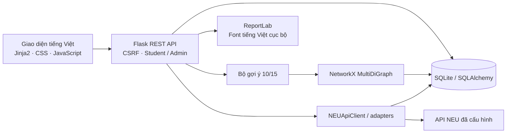
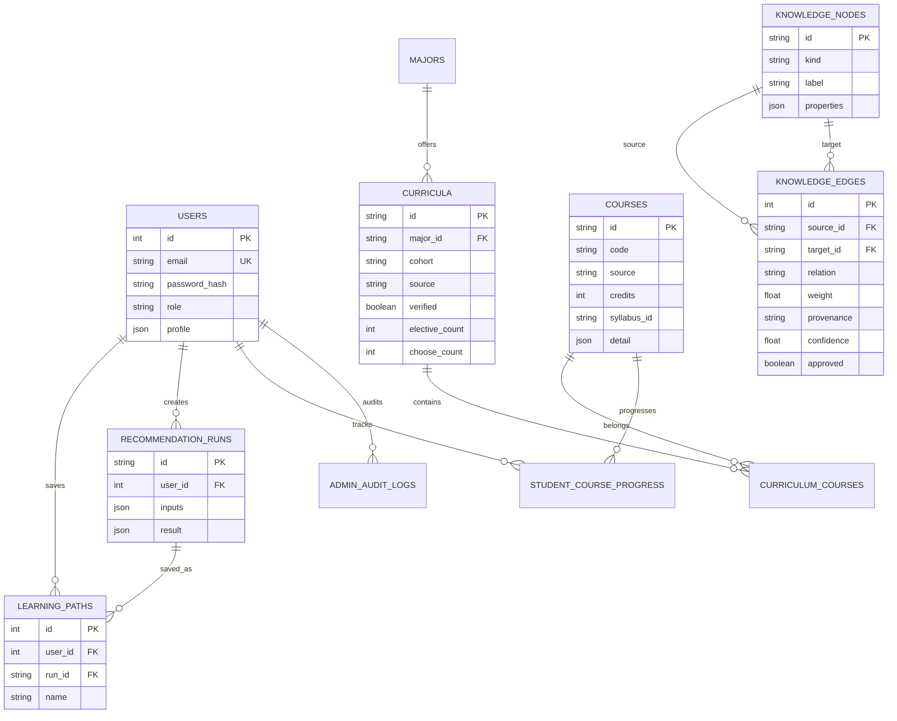
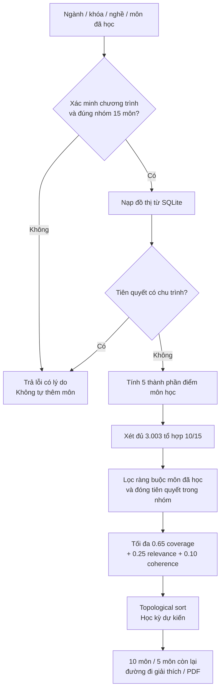

# Kiến trúc và mô hình dữ liệu

Ứng dụng chạy cục bộ, không cần Docker, Neo4j hoặc dịch vụ AI trả phí. Flask phục vụ Jinja2, REST API và toàn bộ tài nguyên tĩnh. SQLite lưu dữ liệu và NetworkX nạp lại đồ thị từ các bảng `knowledge_nodes`, `knowledge_edges` mỗi khi cần tính toán. Không dùng danh sách môn viết cứng theo nghề nghiệp để thay thế thuật toán.

Mô hình được thu gọn thành 15 bảng, thay vì sao chép cùng một quan hệ vào nhiều bảng chuyên biệt. Nghề–kỹ năng, môn–kỹ năng, môn–chủ đề, tiên quyết, bài học và chuẩn đầu ra biểu diễn bằng các loại nút và cạnh. Đề cương và nội dung nguyên bản nằm trong JSON `courses.detail`; đây là chủ đích của phiên bản triển khai này, khác mô hình 26 bảng trong bản yêu cầu ban đầu.

`skills`, `careers` quản lý tên, mô tả và từ đồng nghĩa. `sync_jobs` lưu trạng thái đồng bộ và chi tiết từng nguồn. `settings` lưu phiên bản bộ dữ liệu và cấu hình trọng số. Khóa ngoại SQLite được bật tại thời điểm kết nối. Membership chương trình dùng khóa chính kép; cạnh dùng ràng buộc duy nhất `(source_id, target_id, relation)`.

Nút có 8 loại: Major, Curriculum, Course, Topic, Skill, Career, Lesson, LearningOutcome. Cạnh có 9 quan hệ theo bản yêu cầu. Cạnh có `provenance`, `confidence`, `approved`. Chỉ cạnh đã duyệt được sử dụng cho gợi ý.

Điểm học phần dùng 45% kỹ năng, 25% chủ đề, 15% đường liên hệ trong đồ thị, 10% kiến thức nền và 5% sở thích. Các trọng số chỉnh được trong Admin. Mức bao phủ kỹ năng của tổ hợp lấy mức hỗ trợ cao nhất trên mỗi kỹ năng, không cộng trùng nhiều môn. Cùng dữ liệu và trọng số cho cùng kết quả; phá hòa bằng thứ tự mã môn.

Các môn tiên quyết bắt buộc ngoài nhóm không tính vào 10 học phần. Trạng thái chưa hoàn thành tiên quyết vẫn hiển thị rõ; lịch chỉ là dự kiến, không cam kết lớp thực tế được mở. Không giả định mọi chương trình chính thức đều áp dụng quy tắc 10/15.
